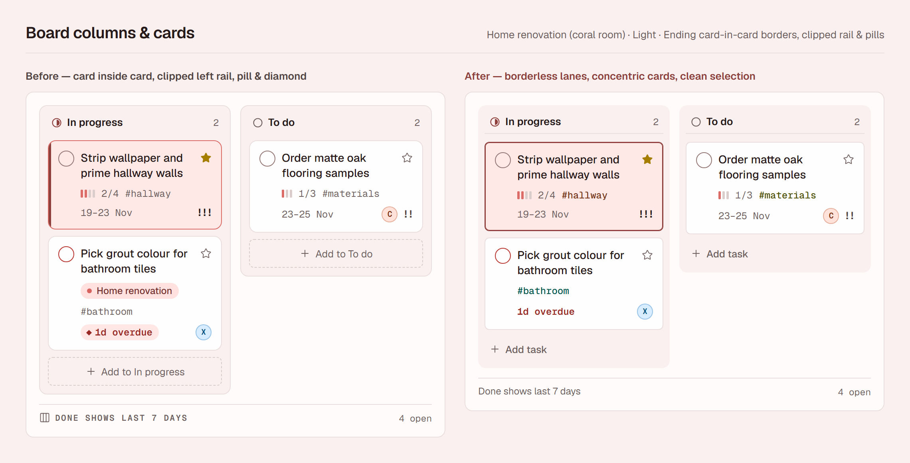

# Design audit: retiring indicator dots and generic UI tells

**Scope:** Visual audit of the shipped GPUI desktop app, Leptos web app, and Android (Compose) app against the Playful design language (`docs/design-language.md`), followed by a concrete replacement system, exact `todo-design` token changes, before/after mockups, and a proposed diff to `docs/design-language.md`.

**Design thesis:** Playful already has a genuine, unmistakable visual identity — OKLCH room atmospheres, the Daybreak horizon and sun, Geist paired with Geist Mono, round checkboxes, crisp agent letter marks (`C`, `X`, `π`, `A`), and bespoke single-stroke hand-drawn list glyphs (`assets/icons/glyphs/`). Where the shipped UI looks generic or "AI-generated", it is almost always because later features reached for default SaaS shorthand — **6 px status LEDs, pastel pill capsules, sparkles icons, card-inside-card boxes, clipped left accent rails, and letter-spaced ALL-CAPS labels** — instead of using the typographic and glyph vocabulary the product already owns.

---

## 1. Evidence reviewed

Screenshots were inspected zoomed in across all three clients:

- **Desktop (GPUI):** freshly rendered via `pwsh apps/desktop/scripts/gallery.ps1` into `apps/desktop/target/gallery/`, inspecting `my-day-light-100.png`, `my-day-dark-100.png`, `sidebar-footer-light-100.png`, `sidebar-footer-min-light-100.png`, `sync-failures-light-100.png`, `tag-picker-light-100.png`, `list-status-light-100.png`, `list-settings-light-100.png`, `board-light-100.png`, `board-detail-light-100.png`, `timeline-light-100.png`, `timeline-planned-light-100.png`, `activity-light-100.png`, `task-links-light-100.png`, `account-menu-light-100.png`, `popout-pinned-light-100.png`, `ai-empty-light-100.png`, `ai-proposal-light-100.png`, `ai-batch-light-100.png`, `ai-settings-light-100.png`, `ai-error-light-100.png`, and `ai-blocked-light-100.png`.
- **Web (Leptos / wasm32):** freshly built with `node apps/web/scripts/build.mjs --fixtures` and rendered via Playwright into `apps/web/e2e/gallery/`, inspecting `desktop-light.png`, `sidebar-light.png`, `organize-tags-light.png`, `activity-light.png`, `phone-light.png`, and `phone-drawer-light.png`.
- **Android (Compose):** inspected Paparazzi baselines in `apps/android/app/src/test/snapshots/images/`, including `cover_my_day_light.png`, `cover_my_day_dark.png`, `cover_collapsed_light.png`, `cover_collapsed_dark.png`, `cover_switcher_light.png`, `cover_switcher_dark.png`, `cover_board_light.png`, `inner_board_light.png`, `inner_board_detail_light.png`, `cover_list_status_light.png`, `cover_list_settings_light.png`, `cover_detail_light.png`, `organize_rows_light.png`, `organize_tags_light.png`, `organize_activity_light.png`, and `multi_select_light.png`.

---

## 2. Ranked audit findings

Findings are ranked from highest to lowest visual impact across everyday screens.

### Rank 1 — Decorative coloured indicator dots ("status LEDs") everywhere

Small 6–8 px solid circles have become the default crutch for list identity, tag colour, sync health, network privacy, connection state, progress, and unread counts. They appear in **13 distinct UI locations** across all three clients:

| # | Surface | Current rendering | Source & screenshot evidence |
|---|---|---|---|
| 1 | **Task row & handover list chips** | Pastel capsule + 6 px `--list-dot` (`● Work · Planning`) on every row in cross-list rooms, even though every list already has a hand-drawn glyph in `assets/icons/glyphs/`. | Desktop: `apps/desktop/src/ui/kit.rs:201-223`, `my-day-light-100.png`; Web: `apps/web/src/app.rs:1249`, `apps/web/static/app.css:1924`, `desktop-light.png`, `phone-light.png`; Android: `apps/android/app/src/main/kotlin/app/todoornot/ui/Parts.kt:91-104`, `cover_my_day_light.png`. |
| 2 | **Detail pane breadcrumb** | `[● Work] / Planning` capsule + dot at the top of the detail pane — even when viewing a single-list room. | Desktop: `apps/desktop/src/ui/shell/detail.rs:693`, `sidebar-footer-light-100.png`; Web: `desktop-light.png`; Android: `cover_detail_light.png`. |
| 3 | **Detail tags row & Tag Picker** | Drops `#` and replaces it with coloured dots (`● planning  ● q4`), contradicting task rows (`#planning #q4`). In Tag Picker popovers, 6–11 coloured dots stack into a vertical traffic-light column. On Android `organize_tags_light.png`, the dot sits outside the selected row's highlight pill. | Desktop: `apps/desktop/src/ui/shell/detail.rs:1503`, `menu.rs:1928`, `tag-picker-light-100.png`; Web: `apps/web/src/app/tags.rs:180,293,320`, `app.css:1106`, `organize-tags-light.png`; Android: `Detail.kt:712`, `Organize.kt:206`, `organize_tags_light.png`. |
| 4 | **Sidebar footer sync indicator** | Bright green `--color-success` dot (`● 10:34`) permanently glowing at rest in the middle of the warm apricot sidebar; switches to orange/grey/red dots for Syncing / Offline / Error. | Desktop: `apps/desktop/src/ui/shell/sidebar.rs:470`, `sidebar-footer-light-100.png`, `sync-failures-light-100.png`; Web: `apps/web/src/app/room_actions.rs:425`, `app.css:722`, `sidebar-light.png`; Android: `RoomSwitcher.kt:442`, `cover_switcher_light.png`. |
| 5 | **Assistant Settings provider card (two green dots in one card)** | Top-right `● PRIVATE NETWORK` / `● TAILSCALE` AND bottom `● Connected · 4 models · 38 ms` — two glowing green LEDs stacked inside a single card. | Desktop: `apps/desktop/src/ui/shell/assistant/views.rs:1772,1902`, `ai-settings-light-100.png`. |
| 6 | **Assistant panel footer** | `● Private network · local-model ▾` (green at rest, red when unreachable — using a 6 px red dot to say "server unreachable"). | Desktop: `apps/desktop/src/ui/shell/assistant/views.rs:664`, `ai-empty-light-100.png`, `ai-error-light-100.png`, `ai-blocked-light-100.png`. |
| 7 | **Assistant proposal cards & Ask AI trigger** | `[● Finance]` pill top-right, `● Pay quarterly VAT filing ↗` inside the nested task-link box, 5× `[● Errands]` pills in batch proposals, and a pending orange dot inside `[✨ Ask AI ● Ctrl J]`. | Desktop: `apps/desktop/src/ui/shell/assistant/views.rs:224,988,1467`, `ai-proposal-light-100.png`, `ai-batch-light-100.png`. |
| 8 | **Sidebar `Agent activity` unread pip** | `● 6 new` / `● 2 new` puts a dot directly before text that already reads `new` in `accent-strong`. | Desktop: `apps/desktop/src/ui/shell/sidebar.rs:560`, `my-day-light-100.png`; Web: `apps/web/static/app.css:540`, `sidebar-light.png`. |
| 9 | **Timeline cross-list Task Rail & Today ruler** | 11 coloured dots stacked vertically down the left rail of Planned Timeline (`timeline-planned-light-100.png`), plus a 7 px Today ruler dot (`timeline::TODAY_DOT`). | Desktop: `apps/desktop/src/ui/shell/timeline.rs:1103,1199`, `timeline-planned-light-100.png`; Web: `apps/web/src/app/timeline.rs:1168`, `app.css:4113,4143`. |
| 10 | **Android smart-list Room Pills** | `Important` and `Planned` fall back to `● Important` and `● Planned` (`Micro.pillDot = 7.dp`) even though `RoomSwitcher` and the web phone strip already use Lucide `star` and `calendar` icons. | Android: `apps/android/app/src/main/kotlin/app/todoornot/ui/Pills.kt:99`, `cover_my_day_light.png`. |
| 11 | **Android collapsed header (`CompactHeader`)** | Renders `◆ 1  ● 3/12` — an 8 dp filled amber circle next to `3/12` directly above a `2 dp` `sun-ink` progress hairline that already expresses the exact same progress. | Android: `apps/android/app/src/main/kotlin/app/todoornot/ui/Header.kt:250-259`, `cover_collapsed_light.png`, `cover_collapsed_dark.png`. |
| 12 | **Desktop pop-out titlebar** | `● Planning` replaces the list's own hand-drawn flag glyph with a generic circle dot. | Desktop: `apps/desktop/src/ui/shell/popout.rs:345`, `popout-pinned-light-100.png`. |
| 13 | **Android Rooms button, Activity refresh & Pairing** | Green dot floating over the `Rooms` hamburger icon; dot on Desktop/Android `Refresh activity •`; status dot on pairing screen. | Android: `RoomPane.kt:346`, `organize_activity_light.png`; Desktop: `activity.rs:375`, `pairing.rs:716`. |

---

### Rank 2 — Pill-everything badges, pastel rainbow confetti, and geometric micro-bullets

`docs/design-language.md` states *"Pills are rationed"*, yet everyday screens are crowded with competing capsules and micro-shapes:

- **Rainbow pastel noise vs. room atmosphere:** In `My Day` (`my-day-light-100.png`, `desktop-light.png`, `cover_my_day_light.png`), 7–9 pastel pills in cyan, mint, green, rose, coral, and blush stack vertically down the list, directly fighting the room's warm apricot OKLCH atmosphere.
- **Phone metadata starvation:** On `apps/web/e2e/gallery/phone-light.png`, each pastel list pill burns 22–28 px on horizontal padding, a 6 px dot, and a 6 px gap — forcing list names and tags to clip to `[● Work · P...] 2/5 ✉ #..`. Web phone room pills (`[☀ My Day] [☆ Important] [📅 Planned] [💼 Work]`) also flood the top strip with four competing pastel `--list-tint` fills.
- **Double micro-shape clutter:** The overdue badge pairs a rotated 5 px square diamond (`◆ 2d overdue`) with a pastel red capsule, right beside a circular dot inside a pastel list capsule (`[● Work · Finance]`).
- **Pill creep into workflow & filters:** `[◐ In progress]` renders as a `4 px` tinted chip right beside `[◆ 1d overdue]` (`10 px` pill) on `list-status-light-100.png` and `cover_list_status_light.png`. Android Activity renders four filter pills (`[All] [C Claude] [X Codex] [π Pi]`) in `organize_activity_light.png`.

---

### Rank 3 — Accent rails cut off by rounded corners *(related patterns — fix in progress elsewhere)*

The owner already flagged accent rails clipped by rounded corners, and a dedicated fix is underway elsewhere. For completeness across clients, the audit found **six surfaces** exhibiting this pattern (either visibly clipped today, or stacking a left bar on top of a bordered rounded card):

1. **Desktop AI Settings provider card** (`apps/desktop/src/ui/shell/assistant/views.rs:1748`, `ai-settings-light-100.png`): `PROPOSAL_BAR` (`3 px`) inside `overflow_hidden` + `radius::LG` (`10 px`) is visibly sliced into diagonal wedges at top-left and bottom-left.
2. **Desktop AI proposal & error cards** (`views.rs:809,1115`, `ai-proposal-light-100.png`, `ai-batch-light-100.png`, `ai-error-light-100.png`): both the `3 px` orange/red proposal bar and `.border_l(3 px)` on the error panel clip sharply at the `10 px` rounded corners.
3. **Desktop & Web Timeline bars** (`apps/desktop/src/ui/shell/timeline.rs:1355-1363`, `apps/web/static/app.css:4169-4171`, `timeline-light-100.png`, `timeline-planned-light-100.png`): the `3 px` left cap on `In progress` and cross-list bars is clipped by `radius::MD` (`6 px`) corners on every bar.
4. **Android `BoardCard`** (`apps/android/.../ui/Board.kt:373-375`, `inner_board_detail_light.png`): `.clip(RoundedCornerShape(10.dp))` + full-height `selectionBar(3.dp)` slices the left bar at both corners, and triple-stacks selection (`wash` fill + `1 px accent` border + `3 px` left bar).
5. **Android `SmartTile` & Activity `All` pill** (`RoomSwitcher.kt:256-259`, `cover_switcher_light.png`, `organize_activity_light.png`): full-height `3 dp` selection bars clipped inside `6 dp` rounded tiles and even sliced into a crescent inside a pill-shaped `All` filter button.
6. **Web sidebar active row** (`apps/web/e2e/gallery/sidebar-light.png`): the `3 px` left selection bar on `My Day` meets the `6 px` rounded corner of the active pill row.

---

### Rank 4 — "Card inside card" nesting and stacked borders/shadows

Playful declares *"The design is flat. Surfaces are separated by colour steps and 1 px lines."* Several newer screens wrap cards inside cards with redundant borders:

- **Board view (all 3 clients):** `pane` → `10 px` rounded, `1 px line`-bordered `canvas` column → `10 px` rounded, `1 px line`-bordered `raised` task cards → dashed-border `+ Add to In progress` / empty well (`board-light-100.png`, `inner_board_light.png`). Worse, inner cards and outer columns share the exact same `10 px` radius, creating non-concentric corners.
- **AI Settings modal (`ai-settings-light-100.png`):** `pane` modal card (with `line-strong` border AND shadow) → `raised` provider card (with `accent` border AND `3 px` rail) → bordered inputs (`pane` + `control` border) AND nested `wash` enable strip → separate bordered `canvas` privacy card → bordered `raised` list-permissions card.
- **AI Proposal cards (`ai-proposal-light-100.png`):** bordered `raised` proposal card containing a second bordered `pane` card for the single linked task (`● Pay quarterly VAT filing ↗`).
- **Web Detail pane properties (`apps/web/e2e/gallery/desktop-light.png`):** every property value (`Due`, `Priority`, `Repeat`, `Tags`, `Reminder`) sits inside its own bordered input box of inconsistent width (`Priority` stretches full width with a native select chevron; `Due` shrinks to fit `"Today"`), turning a calm key-value list into a cluttered form.
- **Detail Source/Link cards (`task-links-light-100.png`, `organize_rows_light.png`):** bordered `raised` card containing a second rounded `wash` icon tile around `mail`/`link`.
- **Light-mode border + shadow stacking:** Desktop (`kit.rs:388-398`) and Web (`app.css:636-638,752-754`) draw *both* `shadow-overlay` and a `1 px` `line`/`line-strong` border on light-mode popovers and modals, even though `docs/design-language.md` specifies the `1 px line-strong` border for *dark mode* where shadows barely read.

---

### Rank 5 — `Icon::Sparkles` (`✨`) and redundant iconography

- **Sparkles is the #1 AI-slop icon cliché:** `assets/icons/lucide/sparkles.svg` is used for the `Ask AI` titlebar button, the `Agent activity` sidebar row across all three clients (`my-day-light-100.png`, `sidebar-light.png`, `cover_switcher_light.png`), the AI empty-state hero tile (`ai-empty-light-100.png`), and — most incongruously — inside a warm rounded icon tile right above `"Connection blocked"` on a security/privacy warning screen (`ai-blocked-light-100.png`). Meanwhile, the product already owns a calm, typographic `A` agent letter mark (`Agent::Assistant`).
- **Redundant icons next to explicit text:**
  - Android Detail `Status` row (`inner_board_detail_light.png`): renders `◐` icon + `Status` + `[◐ In progress]` — the exact same glyph twice on a single row.
  - Desktop Activity toolbar (`activity-light-100.png`): `[🕒] NEWEST FIRST`.
  - Desktop Board footer (`board-light-100.png`): `[▥] DONE SHOWS LAST 7 DAYS`.
  - AI Settings list rows (`ai-settings-light-100.png`): `[list glyph] Personal · Errands   [eye] Private only [▾]` — three icons on one row.
- **Triple-repeated network status:** In `ai-empty-light-100.png`, `ai-proposal-light-100.png`, and `ai-blocked-light-100.png`, the exact same network label (`Tailscale` / `Not private`) appears simultaneously in the panel header, the panel footer, and the window status bar directly beneath it.

---

### Rank 6 — Letter-spaced ALL-CAPS mono micro-labels (`CAPS_LABEL`) everywhere

`CAPS_LABEL` (`Geist Mono` 600, `10.5 px`, `+0.12em` tracking, uppercase) is used across **25+ unrelated roles**: detail section titles (`STEPS`, `NOTES`, `SOURCE`, `LINKS`, `ATTACHMENTS`, `ACTIVITY`, `SCHEDULE AND PRIORITY`), modal headings (`MODEL PROVIDER`, `LISTS THE ASSISTANT CAN SEE`, `LIST SETTINGS`), status badges (`PRIVATE NETWORK`, `TAILSCALE`), disclosure buttons (`COMPLETED 3`, `UNSCHEDULED · 2`, `SHOW TRAY`), sort labels (`NEWEST FIRST`), footer notes (`DONE SHOWS LAST 7 DAYS`), proposal headers (`EDIT TASK`, `5 NEW TASKS`, `REPLY UNAVAILABLE`), and tag popover titles (`TAGS`).

Overusing tracked micro-caps flattens hierarchy and gives the app a generic SaaS/dashboard template voice instead of Playful's editorial Geist typography.

---

### Rank 7 — Default-looking toggles, double-bordered segmented controls, and radius drift

- **Alien switches & checkboxes:** Android List Settings (`cover_list_settings_light.png`) uses a chunky stock Material 3 `Switch`; Desktop (`list-settings-light-100.png`) and Web (`app.css:3768-3786`) use generic iOS-style `36 × 20` pill switches; and the AI assistant design mockups use a square checkbox instead of Playful's signature round checkbox.
- **Double-bordered segmented controls:** Desktop and Web `List | Board | Timeline` and `Default view` tracks (`list-status-light-100.png`, `list-settings-light-100.png`, `workflow.rs:206-250`) place a bordered `raised` active button inside a bordered `canvas` container. Android `ViewSegments` (`Workflow.kt:157-177`, `inner_board_light.png`, `cover_list_settings_light.png`) glues three individually bordered rounded rectangles side-by-side, producing double vertical hairlines between segments.
- **Radius fragmentation:** The same metadata row mixes `radius::SM` (`4 px` on `In progress`), `radius::CHIP` (`10 px` pill on list & overdue badges), and `50%` circles; Board nests `10 px` cards inside `10 px` columns; Android `SmartTile` uses `6 dp` while `BoardCard` uses `10 dp`.

---

## 3. Concrete replacement system

Every replacement follows one test: **Does it use Playful's existing materials (Geist, Geist Mono, OKLCH room ink/wash, hand-drawn list glyphs, Lucide 1.6 strokes, 1 px hairlines) so that removing all colour would still leave the hierarchy intact?**

### 3.1 Task rows & breadcrumbs: hand-drawn glyph + tinted ink, zero pills, zero dots

- **Single-list rooms:** Show no list label at all (unchanged on task rows; extended to single-list Board cards).
- **Cross-list rooms (My Day, Important, Planned, All, Search, Collections, Cross-list Timeline):**
  - Replace `[● Work · Planning]` with the list's **14 px hand-drawn glyph** (`assets/icons/glyphs/`, coloured in `--list-glyph`) followed by a `5 px` gap and plain text: collection prefix `Work ·` in `--color-ink-3` (regular) + list name `Planning` in `--list-ink` (medium `500`), **no background pill, no border, no dot**.
  - **Phone rows:** Show glyph + list name (`[$] Finance`) without collection prefix unless two lists share a name. Recovering the 22–28 px previously spent on pill padding and the dot stops phone rows from clipping list names and `#tags`.
  - **Detail breadcrumb:** `[16 px glyph in --list-glyph] Work / Planning` (collection in `ink-3`, list name in `--list-ink`), plain text on `pane`, zero pill/dot.
  - **Desktop pop-out titlebar:** `[16 px glyph in --list-glyph] Planning`, never `● Planning`.
  - **Timeline cross-list Task Rail:** `14 px` list glyph in `--list-glyph` on the left of each task row instead of a coloured dot.
  - **Contrast verified:** Across all 12 swatches and all room hues in `crates/todo-design/generated/tokens.json`, `ListColors::ink` already achieves **≥ 8.21:1 on `pane`**, **≥ 7.28:1 on `wash`**, and **≥ 6.90:1 on `selection-wash`** in light mode (**≥ 7.91:1** everywhere in dark mode). `ListColors::glyph` already achieves **≥ 4.61:1 on `pane`** and **≥ 4.09:1 on `wash`** in light mode (**≥ 7.25:1** in dark mode), well above the 3:1 graphic minimum.

### 3.2 Tags: `#tag` in tinted Geist Mono everywhere

- **One representation on every surface** (task rows, board cards, detail pane `# Tags` row, and tag pickers): `#tag` in `Geist Mono` (`ty::TAG`, `12/16`, `500`) coloured in the tag swatch's `--list-ink` directly on the surface. **No pill, no box, no coloured dot.**
- **Tag Picker & menus:** Each row renders `#tagname` where `#` is tinted in `--list-glyph` (or the whole `#tagname` is tinted in `--list-ink`) with a trailing `check` icon when active — zero traffic-light dot column. On Web detail pane, remove the bordered box around `# Tags` so tags sit flush like Desktop.

### 3.3 Overdue and workflow status: typographic weight & Lucide outline, zero pills

- **Overdue (`2d overdue`, `yesterday`):** Retire the rotated diamond `◆` and the `danger-bg` pill capsule. Render `2d overdue` directly on `pane`/`wash` in `Geist Mono` `600` (`ty::OVERDUE`, `12.5/20`) coloured in `danger-ink`. Paired with the `danger` red checkbox ring, this honours *"at most two reds"* with crisp typographic tension instead of a badge. Worst-case contrast of `danger-ink` across all rooms is **≥ 6.30:1** on `pane`, `wash`, `selection-wash`, and `sky` in light mode (**≥ 7.47:1** dark).
- **Workflow status (`In progress`, `To do`, `Backlog`):** Render inline without a chip box: `14 px` Lucide status glyph (`status-progress` in `accent-strong`; `status-todo` / `status-backlog` in `ink-3`) + label in `ink-2` (`500` for `In progress`, `400` for others). In Android/Desktop Detail's `Status` property row, show the status glyph **once** (next to the value), using a neutral `sliders-horizontal` or `columns-3` icon for the row label so the same glyph never appears twice on one line.

### 3.4 Sync, connection, and privacy states: silence when healthy, icons only on faults

**Core rule:** A healthy background connection is the baseline, not an event. Never light up a green LED to announce that nothing is wrong.

| State | Sidebar footer (248 px / 200 px min) | Android `Rooms` button | Assistant settings & footer |
|---|---|---|---|
| **Healthy / resting** | `Synced 10:34` (min width: `10:34`) in `ink-3` mono. **No dot, no green.** | Plain `☰ Rooms` — **no dot**. | Settings header: `Private network · no cloud fallback` in `ink-3` mono; test result `Connected · 4 models · 38 ms` in `ink-2` mono. Panel footer: `Private · local-model ▾` in `ink-2` (drop redundant header repetition). |
| **In progress** | `Syncing…` in `accent-strong` mono. No dot, no spinner. | Plain `☰ Rooms`. | `Connecting…` / `Testing…` in `accent-strong` mono. |
| **Offline / queued** | `14 px` Lucide `cloud-off` + `Offline · 3` in `ink-2` mono. | Quiet `cloud-off` badge beside `Rooms`. | `cloud-off` + `Offline · local-model` in `ink-2` mono. |
| **Error / blocked** | `14 px` Lucide `circle-alert` + `3 not synced` in `danger-ink` mono. | `circle-alert` badge in `danger-ink`. | `circle-alert` + `Unreachable · local-model` (or `Not private`) in `danger-ink` mono. |

- **Sidebar `Agent activity` unread count:** Drop the leading dot; render `6 new` directly in `accent-strong` mono (`ty::COUNT`, weight `500`).
- **Activity Refresh button:** Plain text `Refresh` (or Lucide `refresh-cw` + `Refresh`), never `Refresh activity •`.

### 3.5 AI identity: retire `sparkles.svg`

- Delete `assets/icons/lucide/sparkles.svg` from the bundled icon set.
- **Assistant trigger, empty state, and blocked state:** Use the product's own **`A` letter mark** (`Agent::Assistant`) on the titlebar button (`[A] Assistant  Ctrl J`, showing a plain `accent-strong` mono count `1` instead of an orange dot when proposals await review) and above the empty-state heading. On `Connection blocked`, use Lucide `circle-alert` in `danger-ink`, never sparkles.
- **`Agent activity` smart list:** Add Lucide `terminal` (`>_`, stroke `1.6`, zero face/mascot/dot) to `assets/icons/lucide/` for the `Agent activity` smart-list row and Android smart tile.

### 3.6 Android compact header & room pills

- **`CompactHeader` (`36 dp`):** Remove both `◆` and the `8 dp` `sun-ink` circle dot. Keep the `2 dp` `sun-ink` horizon progress hairline along the bottom edge, and format the trailing summary cleanly in mono: `1 overdue · 3/12` (`1 overdue` in `danger-ink` 600, `·` in `ink-4`, `3/12` in `ink-2`), or `3/12` alone when nothing is overdue.
- **Phone Room Pills (Android & Web):**
  - Every smart list uses its Lucide icon (`sun`, `star`, `calendar`, `list`, `circle-check`, `terminal`) in `--list-glyph` — **never** a dot fallback.
  - Inactive room pills use neutral `pane` fill + `1 px line` border across **both** Android and Web (retiring Web's pastel rainbow inactive pills). Only the **active** room pill takes the filled `--list-strong` / `--list-on-strong` capsule. Room pills become the **only** pill-shaped surface left in the product.

### 3.7 Board columns, flat modals, and selection without clipped rails

- **Board columns (concentric & borderless):** Make each column a **borderless** `canvas` lane (`radius::LG` `10 px`, `8 px` padding, `1 px line` divider under the column header) holding `raised` task cards (`radius::MD` `6 px`, `1 px line` border). Outer `10 px` minus `4–8 px` inset keeps corners visually concentric and kills the card-inside-card double border. Replace the dashed `+ Add to In progress` box with a quiet borderless `+ Add task` row.
- **Selected cards & rounded tiles:** On rounded cards (`BoardCard`, AI proposal cards, Android `SmartTile`), drop full-height left accent rails entirely. Express selection with `wash` fill + a crisp `1.5 px` `accent-strong` border (no corner clipping, no triple-stacking). Reserve `3 px` left selection bars strictly for square-cornered full-bleed list rows (`TaskRow` in desktop/web lists, where the bar is flush with a straight pane edge or inset `6 px` top/bottom).
- **AI Settings modal & light-mode overlays:** Flatten the provider card and list-permissions box into hairline-separated sections directly on `pane` (matching Desktop's detail pane). In light mode, transient overlays use `shadow-overlay` **without** an extra `1 px line-strong` border (keep `1 px line-strong` in dark mode only, as `docs/design-language.md` already specifies).
- **Web Detail properties:** Match Desktop's borderless key-value rows (show a subtle `hover` fill on hover and an `accent` border only while focused/editing), removing the staggered boxes around `Due`, `Priority`, `Repeat`, `Tags`, and `Reminder`.

### 3.8 Typography, switches, segmented controls, and the colour budget

- **Taming `CAPS_LABEL`:** Restrict `CAPS_LABEL` (`Geist Mono` 600, `10.5 px`, `+0.12em` uppercase) to **two structural places only**:
  1. Daybreak header eyebrows (`21 NOV 2026 | W47`, `4 LISTS`, `9 OPEN`, `ALL CHANGES`);
  2. Chronological date dividers in feeds (`TODAY`, `YESTERDAY`, `THU 19 NOV`) and the dusk handover eyebrow (`WHEN THE SUN COMES UP`).
  Convert all other headings (`Steps`, `Notes`, `Source`, `Links`, `Attachments`, `Activity`, `Model server`, `Lists the assistant can see`, `Completed 3`, `Done shows last 7 days`, `Newest first`, `Edit task`) to sentence-case **Geist** (`SECTION_HEADING`: `Geist 600, 12.5/16`, `ink-2` or `ink-3`, normal tracking).
- **Segmented controls (`List | Board | Timeline`, zoom):** Use a **borderless** recessed `canvas` track (`radius::MD` `6 px`, `2 px` inset) containing a **borderless** `raised` active segment (`radius::SM` `4 px`, `ink` 600) — zero double borders on Desktop, Web, or Android.
- **Boolean settings:** Use Playful's round checkbox (`18–20 px` circle, `accent` fill + tick) for settings in modals and popovers (`Enable on this device`, `Ask before switching to a cloud provider`, `Enable workflow statuses`) rather than stock Material 3 or generic iOS pill switches.
- **Where colour is allowed to carry meaning (the strict colour budget):**

| Colour token family | Allowed for | Forbidden for |
|---|---|---|
| **Room `Palette`** (`sky`, `wash`, `accent`, `accent-strong`) | Room atmosphere, Daybreak hills, active selection, due-soon text, primary CTA, checked box, step meter, `Syncing…` text. | Resting status dots, decorative badges, card-in-card outlines. |
| **List `ListColors`** (`glyph`, `ink`, `strong`/`on-strong`) | Hand-drawn list glyphs (`glyph`), list names & `#tags` (`ink`), active phone room pill (`strong`). | Background tints behind task-row chips, dots, inactive web room pills. |
| **Fixed `danger` / `danger-ink`** | Overdue checkbox ring, overdue mono text, sync/connection failure icon & text, destructive confirmation buttons. | Pill capsules (`danger-bg` retired from rows), decorative diamonds. |
| **Fixed `sun` / `sun-ink` / `important-fill`** | Landscape sun, horizon progress stroke, filled My Day toggle, filled Important star. | Compact header dots, generic warning badges. |
| **Fixed `success`** | **Deprecated for resting UI.** Only transient confirmation if ever needed; healthy sync/connection uses neutral `ink-2`/`ink-3`. | Permanent green LEDs (`● 10:34`, `● Connected`, `● PRIVATE NETWORK`). |

---

## 4. Exact `todo-design` token changes

| Action | Token (`crates/todo-design`) | Rationale / exact spec |
|---|---|---|
| **Deprecate / remove** | `ListColors::dot` (`--list-dot`) | Retires every 6 px coloured list/tag dot across all clients. |
| **Deprecate / remove** | `ListColors::tint` (`--list-tint`) | Retires pastel list pill backgrounds and web inactive room pill fills. |
| **Deprecate / remove** | `Palette::success` (`--color-success`) | Retires permanent green status LEDs in sidebar footer and AI settings. |
| **Deprecate / remove** | `component::CHIP_DOT`, `component::PRIVACY_DOT`, `timeline::TODAY_DOT` | Removes dot geometry tokens; Timeline Today marker uses the `2 px` vertical hairline (`timeline::TODAY_LINE`) + a flush `accent-strong` ruler label instead of a ball-on-stick dot. |
| **Deprecate / remove** | `radius::CHIP` (`10.0`) | No more pill-shaped list or overdue chips; only `radius::ROOM_PILL` (`16.0`) remains pill-shaped. |
| **Deprecate / remove** | `Icon::Sparkles` (`assets/icons/lucide/sparkles.svg`) | Replaced by `Agent::Assistant` (`A` mark) and `Icon::Terminal`. |
| **Keep & repurpose** | `ListColors::glyph` (`--list-glyph`), `ListColors::ink` (`--list-ink`) | Used directly on `pane`/`wash` for list glyphs, list names, `#tags`, and detail breadcrumbs. |
| **Add** | `component::GLYPH_SMALL = 14.0` (`--component-glyph-small`) | 14 px hand-drawn list glyph for task-row metadata and Timeline rail (alongside `GLYPH = 16.0` for sidebar/breadcrumbs). |
| **Add** | `typography::SECTION_HEADING` (`Geist 600, 12.5/16, tracking 0`) | Sentence-case section headings (`Steps`, `Notes`, `Model server`, `Lists the assistant can see`) replacing overused `CAPS_LABEL`. |
| **Add** | `Icon::Terminal` (`assets/icons/lucide/terminal.svg`) | Calm Lucide 1.6-stroke icon for the `Agent activity` smart list. |
| **Extend contrast guards** | `Palette::GUARDS` for `"danger-ink"` | Expand from `&["danger-bg"]` to `&["pane", "canvas", "wash", "selection-wash", "sky", "danger-bg"]` at `4.5:1` (verified currently ≥ 6.30:1 light / ≥ 7.47:1 dark). |
| **Add contrast tests** | Cross-swatch test in `crates/todo-design/tests/` | Assert `ListColors::ink` ≥ `4.5:1` and `ListColors::glyph` ≥ `3.0:1` against every room's `pane`, `canvas`, `wash`, and `selection-wash` in both themes (verified currently ≥ 6.90:1 and ≥ 4.09:1 light; ≥ 7.91:1 and ≥ 7.25:1 dark). |

---

## 5. Before / after mockups

All five mockups live in `docs/mockups/de-slop/` and are rendered at 2× from HTML/CSS using the real `crates/todo-design/generated/tokens.css`, bundled `Geist` / `Geist Mono` fonts (`assets/fonts/`), and real SVGs (`assets/icons/`). Re-render via `node docs/mockups/de-slop/render.mjs`. All task and list names are invented sample data.

### 5.1 Desktop task rows, detail breadcrumb & tags


*Replaces pastel list pills and dots with 14 px hand-drawn list glyphs (`--list-glyph`) + `--list-ink` names, unifies tags as tinted mono `#tag` across rows and detail pane, strips the diamond pill from overdue dates, and removes the chip box from `In progress`.*

### 5.2 Assistant settings, provider card & footer


*Removes both green LEDs from the provider card, flattens card-inside-card nesting and the clipped 3 px left rail into hairline sections, switches to Playful's round checkbox, retires `sparkles` in favour of the `A` mark, and replaces the red footer dot with Lucide `circle-alert` + explicit `Unreachable` text.*

### 5.3 Sidebar footer & Agent activity row


*Replaces the resting green sync LED with quiet mono `Synced 10:34` (`10:34` at 200 px min width), keeps `Syncing…` as plain `accent-strong` mono, introduces meaningful Lucide icons (`cloud-off`, `circle-alert`) only when attention is needed, and swaps `sparkles` + dot on `Agent activity` for `terminal` + plain `6 new`.*

### 5.4 Android cover screen — compact header, task rows & bottom dock


*Clears `◆ 1  ● 3/12` in `CompactHeader` to `1 overdue · 3/12` above the existing 2 dp horizon hairline, replaces row pills with list glyphs + tinted `#tags`, restores Lucide icons (`sun`, `star`, `calendar`) to smart-list room pills, and removes the floating green sync dot from `Rooms`.*

### 5.5 Board columns & cards



*Replaces bordered 10 px columns wrapping bordered 10 px cards with borderless `canvas` lanes (`10 px`) and concentric `raised` cards (`6 px`), removes the clipped 3 px selection rail in favour of `wash` + `accent-strong` border, omits redundant single-list pills, replaces dashed add boxes with quiet `+ Add task`, and switches the footer note to sentence case without a redundant icon.*

---

## 6. Proposed diff to `docs/design-language.md`

The diff below is proposed for review and has **not** been applied to `docs/design-language.md` yet.

```diff
--- a/docs/design-language.md
+++ b/docs/design-language.md
@@ -79,19 +79,18 @@
 | Kind | Hue | Dark mode | Used for |
 |---|---|---|---|
 | **Room** (`Palette`) | the room's hue | hue − 10 | canvas, pane, lines, ink, accent, toast, sky, hills, arc |
-| **List** (`ListColors`) | the list's hue | hue − 6 | chip tint and ink, dot, sidebar glyph, active room pill |
+| **List** (`ListColors`) | the list's hue | hue − 6 | list glyph, list name and `#tag` ink, active room pill |
 | **Agent** (`AgentColors`) | the agent's hue | unchanged | letter mark background, letter, ring |
-| **Fixed** | its own | — | danger, success, the sun, the dusk sky |
+| **Fixed** | its own | — | danger, the sun, the dusk sky |
 
 So a whole room changes atmosphere when its hue changes. My Day (hue 65) is warm apricot, and a teal collection is
 cool. The neutrals (canvas, pane, ink) carry a trace of the room's hue, which keeps the grey from looking dead.
 
 Smart lists have fixed hues. Collections and lists pick from twelve **swatches** that are spread around the wheel:
 rose, coral, clay, olive, fern, jade, teal, lagoon, azure, cornflower, orchid and pink. The swatch names are stable
-keys, used in settings, CSS and JSON. Tags take the same swatches, shown as a small dot (the list's `dot` colour) before
-the tag's name. Choosing a colour offers exactly these twelve, as discs in two rows of six with the current one ticked;
-there is no free-form colour.
+keys, used in settings, CSS and JSON. Tags take the same swatches, shown as tinted `#tag` text in Geist Mono (`ink` of
+the tag's swatch, with no dot and no pill). Choosing a colour offers exactly these twelve, as discs in two rows of six
+with the current one ticked; there is no free-form colour.
 
 ### Palette rules
 
@@ -102,7 +101,8 @@
   - Danger is for overdue items.
   - The list hue is for list identity.
   - The sun's amber is for progress.
-- **An overdue row has at most two reds:** the checkbox ring and the overdue badge. Priority stays neutral.
+  - **Healthy state is silent:** never light up a green indicator dot to show that sync or a local server is working.
+- **An overdue row has at most two reds:** the checkbox ring and the typographic overdue label (`danger-ink`). Priority stays neutral.
 - **Priority is never colour.** It is `!` / `!!` / `!!!` in Geist Mono. Count, weight and ink step together from
   `ink-3` up to `ink`.
 - **Translucency** is used in the landscape (the sun's halo, stars, the moon and the dusk rings), in neutral
@@ -141,11 +141,12 @@
   the task-actions menu offers a toggle, its icon shows the same current state as the toolbar.
 - **Selected rows, chips, segments and options:** Use a filled or tinted container (`wash`, or the stronger
   fill for a compact segment) and a stronger label. Selected navigation and task rows also get a 3 px
-  leading selection bar. Preset, tag and list choices retain their tick; for colour-only swatches the tick
-  takes the place of the stronger label. A chip that just identifies a list or tag isn't selected by being
-  coloured. A suggestion offered as a one-shot action isn't a toggle. Checkboxes keep their filled disc and
-  tick when checked, a bare ring when unchecked; a switch needs a filled track **and** a moved thumb.
+  leading selection bar on square-edged rows only — never place a full-height vertical bar inside a rounded
+  card or pill where corners clip it; rounded cards use `wash` fill plus an `accent-strong` border instead.
+  Preset, tag and list choices retain their tick; for colour-only swatches the tick takes the place of the
+  stronger label. A list label or `#tag` isn't selected by being coloured. A suggestion offered as a one-shot
+  action isn't a toggle. Checkboxes keep their filled disc and tick when checked, a bare ring when unchecked;
+  boolean settings in modals and popovers use the same round checkbox rather than stock OS pill switches.
 - **Contrast and focus:** Both the off outline and the on glyph must reach 3:1 on the surfaces they sit on,
   in light and dark, including a selected row. Keep labels at 4.5:1. A tinted background alone may be subtle;
   pair it with a contrast-checked tick, bar or equivalent state mark. Keyboard focus adds a distinct ring
@@ -167,8 +168,8 @@
 | Family | Role | Examples |
 |---|---|---|
 | **Geist** | room titles, eyebrows, empty states and all interface text | desktop room title at 600, 42/48, −0.04em; upright accent eyebrow at 500, 13/22; task titles at 500, 15/20; detail title at 600, 21/28 |
-| **Geist Mono** | content you compare or scan as data | due times, counts, tags (`#tax`), keycaps, priority and `CAPS LABELS` at +0.12em |
+| **Geist Mono** | content you compare or scan as data | due times, counts, tags (`#tax`), keycaps, priority and structural `CAPS LABELS` (eyebrows and feed date dividers only) |
 
 Size, weight and spacing give Geist its hierarchy without changing family: the room title is compact and
 semibold, while the empty-state line is regular and uses `ink-2`. Geist Mono keeps a visible distinction
@@ -176,6 +177,10 @@
 glance: **Collection** `12 LISTS`.
 
 `todo_design::typography` holds the full scale, with desktop and phone variants. Don't add sizes ad hoc: add a
 named style.
+
+**Restraint on `CAPS_LABEL`:** Tracked uppercase mono is reserved strictly for Daybreak header eyebrows and
+chronological feed dividers (`TODAY`, `YESTERDAY`, `WHEN THE SUN COMES UP`). Detail pane headings (`Steps`,
+`Notes`, `Links`, `Attachments`, `Activity`), modal section headings, disclosure counts (`Completed 3`) and
+footer notes use sentence-case Geist (`SECTION_HEADING` or `META`).
 
@@ -253,10 +258,11 @@
    existing shortcut. Enter or Space opens the menu, arrows move between choices, and Escape closes it and
    returns focus to **+ New**. Sync shows its coloured dot and a short label (for example, **20:18**,
-   **Syncing…**, or **Offline · 3**); a tooltip or accessible description keeps the full wording. At the
-   minimum sidebar width, only the sync label can truncate. **Settings** uses the same menu keys. It
+   Sync is expressed in calm mono text without a status dot: **Synced 20:18** at rest (shortening to **20:18**
+   at minimum sidebar width), **Syncing…** in `accent-strong`, and a meaningful 14 px Lucide icon only on
+   faults (**cloud-off** for **Offline · 3**, **circle-alert** for **3 not synced** in `danger-ink`); a tooltip
+   or accessible description keeps the full wording. At the minimum sidebar width, only the sync label can
+   truncate. **Settings** uses the same menu keys. It
@@ -287,13 +293,14 @@
 - Below **556** px of room width, the metadata line starts under the title as usual, but can use the empty
   space beneath the trailing columns. It reads list chip, steps, source mark (mail), then tags, so the compact
-  indicators are never the ones pushed out. A list chip is at most **180** wide (`desktop::CHIP_MAX`) and ends in an ellipsis inside the
-  pill. Tags that don't fit whole collapse into a mono `+N`; nothing is ever cut mid-glyph. In a narrow column the
-  items give way in order (tags, then the mail mark, then the step meter, then the step count) and the chip narrows
-  last, down to its dot and an ellipsis.
+  indicators are never the ones pushed out. List identity uses the list's 14 px hand-drawn glyph (`--list-glyph`)
+  and plain name (`--list-ink`, with any collection prefix in `ink-3`), with no pill and no dot; single-list
+  rooms omit it altogether. It caps at **180** wide (`desktop::CHIP_MAX`) and ends in an ellipsis. Tags are
+  tinted mono `#tag` text (`--list-ink`) and collapse into a mono `+N` when they don't fit; nothing is ever cut
+  mid-glyph. In a narrow column the items give way in order (tags, then the mail mark, then the step meter, then
+  the step count) and the list label narrows last, down to its glyph and an ellipsis.
@@ -351,9 +358,10 @@
-**Pills are rationed.** Only three things are pill-shaped: list chips (a 6 px dot, a 6 px gap and 8 px padding),
-the overdue badge and phone room pills. Tags are plain mono `#tag` text. Suggestions get a compact chip with a
-6 px radius, not a banner.
+**Pills are rationed.** Only one surface is pill-shaped: phone room pills (and only the active room pill takes
+a colour fill; inactive room pills stay neutral `pane` with a 1 px `line` border and a Lucide icon or list glyph,
+never a dot). List references use a hand-drawn glyph + tinted text; overdue uses bold `danger-ink` mono text
+with no diamond and no pill; tags are tinted mono `#tag` text everywhere (rows, cards, detail pane and pickers).
+Suggestions get a compact button with a 6 px radius, not a banner.
@@ -384,12 +392,13 @@
 | Element | Radius |
 |---|---|
 | checkbox, agent mark | circle |
-| list chip, overdue badge | 10 (pill) |
 | phone room pill | 16 (pill) |
-| quick-add, toast, popover, card | 10 |
-| button, suggestion chip, icon button, sidebar item | 6 |
+| quick-add, toast, popover, board lane | 10 |
+| button, suggestion chip, icon button, sidebar item, board card | 6 |
 | keycap | 4 |
 | phone composer | 12 |
 
 The round checkbox belongs to Playful. Everything else keeps the shared small radii, so inputs, feedback and chips
-stay distinct from each other.
+stay distinct from each other. Nested surfaces step down concentrically (for example, `6 px` cards inside
+borderless `10 px` `canvas` board lanes) and never wrap one bordered card inside another.
@@ -399,11 +408,12 @@
 The design is **flat**. Surfaces are separated by colour steps and 1 px lines.
 
 - A focused input gets an `accent` border plus a 3 px ring in `tint`.
 - There is exactly one shadow, a soft two-layer one for transient overlays: menus, popovers and the date picker.
-  In dark mode it comes with a 1 px `line-strong` border.
+  In light mode the shadow stands alone without an extra outer border; in dark mode it comes with a 1 px
+  `line-strong` border.
+- Segmented controls sit on a borderless recessed `canvas` track with a borderless `raised` active segment —
+  never a bordered button inside a bordered container.
 - Nothing is blurred.
@@ -746,15 +756,15 @@
 #### 10. Sync status changes
 
 - **Trigger:** `SyncClient` transitioning between `Synced`, `Syncing`, `Offline`, and `Error` / `Couldn't sync`.
 - **Hard rule:** **Nothing spins, pulses, or breathes.** Syncing is calm text and colour, never a rotating arrow
-  or pulsing dot.
+  or pulsing dot. Healthy state never shows a coloured indicator dot.
 - **What moves & properties:**
-  - **Status dot & label (`CONTENT_SWAP` 120 ms, `STANDARD`):** Dot colour crossfades (`success` for Synced,
-    `accent` for Syncing, `ink-4` for Offline, `danger` for Error) alongside a crossfade of the status label
-    (for example, `20:18`, `Syncing…`, `Offline · 2`).
+  - **Status label & fault icon (`CONTENT_SWAP` 120 ms, `STANDARD`):** Text colour and copy crossfade
+    (`ink-3` `Synced 20:18` at rest, `accent-strong` `Syncing…`, `ink-2` `cloud-off` + `Offline · 2`, or
+    `danger-ink` `circle-alert` + `2 not synced`).
 - **Anti-flicker debounce:** Wait `300 ms` before showing transient `Syncing…` so fast background round-trips
   do not blink the footer.
 - **Status-bar notice / Retry action:** Enters in place over `TOAST_IN` (`180 ms`, `ENTER`, `opacity: 0 → 1`)
   without shifting the task list above it.
 - **Stagger:** None.
-- **Reduced motion:** Dot and label crossfade in `REDUCED_FADE` (`100 ms`), zero movement; the `300 ms` debounce
+- **Reduced motion:** Label crossfades in `REDUCED_FADE` (`100 ms`), zero movement; the `300 ms` debounce
   stays unchanged.
@@ -942,10 +952,11 @@
 - **Interface icons come from one set: Lucide.** They are stroke icons on a 24-unit grid with round caps, and
   they're bundled at stroke 1.6. Draw them at 18 px in toolbars and rows, and at 14 px inside chips and metadata.
   Never mix in another set, and never use emoji as icons. Windows caption buttons are OS chrome and use
   a matching set of custom minimize, maximize, restore and close marks.
+  Never use `sparkles` (`✨`) for AI features: use the `A` letter mark for the Assistant and `terminal` for Agent activity.
 - **The hand-drawn list glyphs** are the app's own: sun, briefcase, layers, house, flag, coin, paperclip,
   calendar-star, code, wrench, book, basket, heart, paper-plane and document. They are slightly irregular single
-  strokes, drawn at 16 px in the list's `glyph` colour. They give the sidebar and the phone room pills character
-  without colour blocks.
+  strokes, drawn at 16 px in the sidebar, breadcrumbs and room pills, and at 14 px (`GLYPH_SMALL`) in task rows
+  and the timeline rail, in the list's `glyph` colour. They carry list identity everywhere without colour blocks or dots.
@@ -968,9 +979,14 @@
 - purple-to-blue gradients, and gradients in general (only the Daybreak sky on Android and finished dusk use them);
 - glassmorphism, background blur and frosted panels;
 - emoji used as icons;
+- sparkles (`✨`) icons for AI features;
+- small coloured "indicator light" status dots (on list chips, tags, sync footers, provider cards, or headers);
+- rotated geometric micro-bullets (`◆`) next to counts or dates;
+- card-inside-card nesting (bordered cards inside bordered columns or modals) and full-height accent rails clipped by rounded corners;
+- tracked ALL-CAPS mono labels used for routine section headings, counts or status notes;
 - floating cards with heavy drop shadows;
 - Inter (or any system sans) on white with no typographic identity;
 - generic SaaS dashboard chrome: stat tiles, KPI rows, sparkline decoration;
 - decoration without meaning, such as extra suns, mascots, confetti or illustrations that measure nothing;
-- pills everywhere (see the pill budget above);
+- pills everywhere (see the pill budget above — only phone room pills are pill-shaped);
 - congratulation copy such as "You crushed it!".
```
