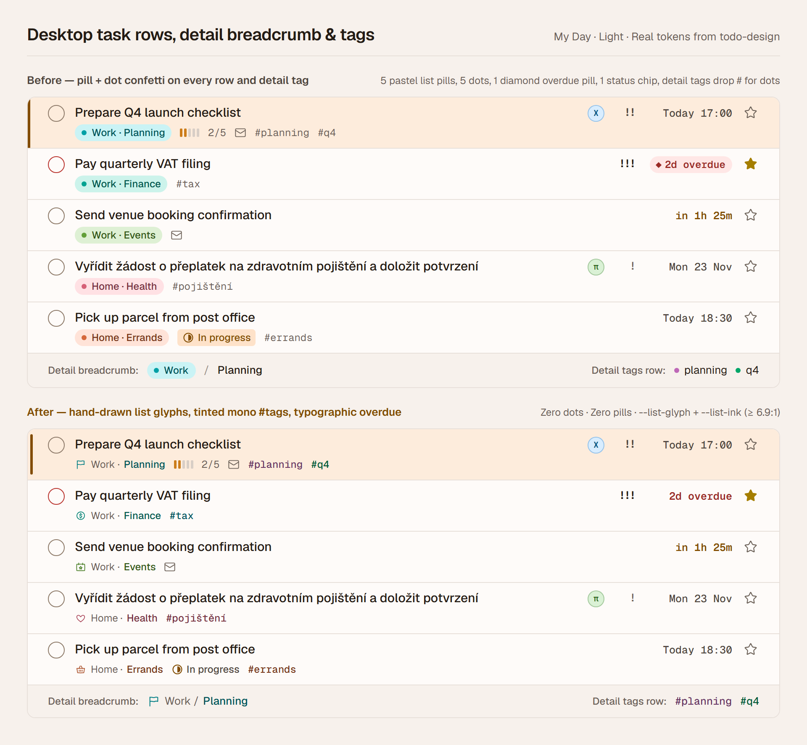
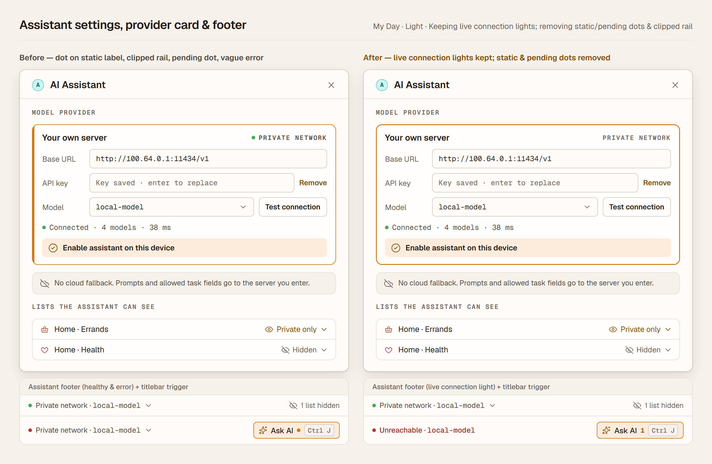
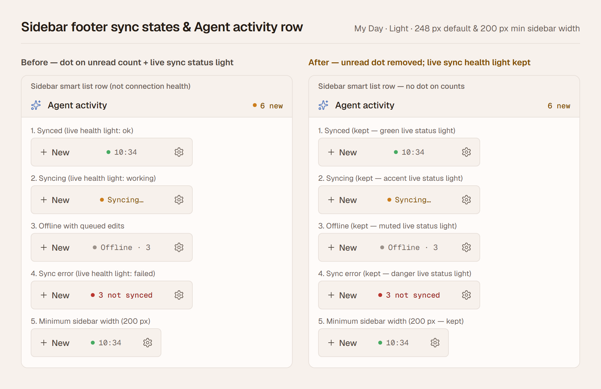
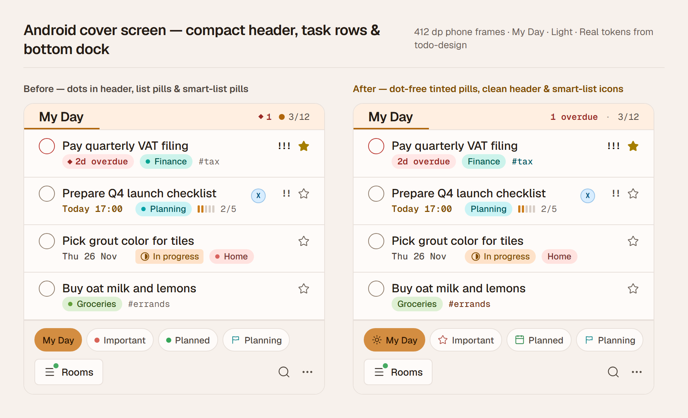

# Design audit: surgical fixes for indicator dots, pill clutter, and clipped rails

**Scope:** Visual audit of the shipped GPUI desktop app, Leptos web app, and Android (Compose) app against the Playful design language (`docs/design-language.md`), followed by a conservative, surgical replacement system, exact `todo-design` token changes, before/after mockups, and a proposed diff to `docs/design-language.md`.

**Guiding principle:** Keep the existing layout structure, section hierarchy, tinted pills, typography, and live connection/sync status lights wherever they work well. Fix only concrete visual defects: **colored dots used for identity, categories, tags, lists, counts, or static labels; rotated diamond micro-bullets (`◆`); and accent rails cut off by rounded corners.**

> **Core status-light rule:** A colored dot is allowed only as a live status light for connection or sync health. It must change with the state (ok / working / failed). It is never used for identity, categories, tags, lists or static labels.

---

## 1. Evidence reviewed

Screenshots were inspected zoomed in across all three clients:

- **Desktop (GPUI):** rendered via `pwsh apps/desktop/scripts/gallery.ps1` into `apps/desktop/target/gallery/`, inspecting `my-day-light-100.png`, `my-day-dark-100.png`, `sidebar-footer-light-100.png`, `sidebar-footer-min-light-100.png`, `sync-failures-light-100.png`, `tag-picker-light-100.png`, `list-status-light-100.png`, `list-settings-light-100.png`, `board-light-100.png`, `board-detail-light-100.png`, `timeline-light-100.png`, `timeline-planned-light-100.png`, `activity-light-100.png`, `task-links-light-100.png`, `account-menu-light-100.png`, `popout-pinned-light-100.png`, `ai-empty-light-100.png`, `ai-proposal-light-100.png`, `ai-batch-light-100.png`, `ai-settings-light-100.png`, `ai-error-light-100.png`, and `ai-blocked-light-100.png`.
- **Web (Leptos / wasm32):** built with `node apps/web/scripts/build.mjs --fixtures` and rendered via Playwright into `apps/web/e2e/gallery/`, inspecting `desktop-light.png`, `sidebar-light.png`, `organize-tags-light.png`, `activity-light.png`, `phone-light.png`, and `phone-drawer-light.png`.
- **Android (Compose):** inspected Paparazzi baselines in `apps/android/app/src/test/snapshots/images/`, including `cover_my_day_light.png`, `cover_my_day_dark.png`, `cover_collapsed_light.png`, `cover_collapsed_dark.png`, `cover_switcher_light.png`, `cover_switcher_dark.png`, `cover_board_light.png`, `inner_board_light.png`, `inner_board_detail_light.png`, `cover_list_status_light.png`, `cover_list_settings_light.png`, `cover_detail_light.png`, `organize_rows_light.png`, `organize_tags_light.png`, `organize_activity_light.png`, and `multi_select_light.png`.

---

## 2. Ranked audit findings (actionable defects)

Findings are ranked by everyday visual impact.

### Rank 1 — Colored dots misused for identity, categories, tags, lists, counts, and static labels (10 UI surfaces)

A colored dot is a **live status light** — it earns its place only when it tracks connection or sync health (ok / working / failed). Across the shipped clients, however, 6–8 px colored dots have leaked onto **10 non-health surfaces** where they carry no live state:

| # | Surface | Current defect | Source & screenshot evidence |
|---|---|---|---|
| 1 | **Task row, board card & handover list chips** | Tinted pill *plus* a redundant 6 px `--list-dot` (`● Work · Planning`). The tinted pill already carries the list's hue and readability; the dot inside it is pure clutter and eats 12 px of horizontal space on phone rows. | Desktop: `apps/desktop/src/ui/kit.rs:201-223`, `my-day-light-100.png`; Web: `apps/web/src/app.rs:1249`, `apps/web/static/app.css:1924`, `desktop-light.png`, `phone-light.png`; Android: `apps/android/app/src/main/kotlin/app/todoornot/ui/Parts.kt:91-104`, `cover_my_day_light.png`. |
| 2 | **Detail pane breadcrumb** | `[● Work] / Planning` puts a redundant dot inside an already tinted collection pill. | Desktop: `apps/desktop/src/ui/shell/detail.rs:693`, `sidebar-footer-light-100.png`; Web: `desktop-light.png`; Android: `cover_detail_light.png`. |
| 3 | **Detail tags row & Tag Picker** | Drops `#` and replaces it with colored dots (`● planning  ● q4`), contradicting task rows (`#planning #q4`). Tag Picker popovers stack 6–11 dots into a vertical traffic-light column. On Android `organize_tags_light.png`, the dot sits outside the selected row's highlight. | Desktop: `apps/desktop/src/ui/shell/detail.rs:1503`, `menu.rs:1928`, `tag-picker-light-100.png`; Web: `apps/web/src/app/tags.rs:180,293,320`, `app.css:1106`, `organize-tags-light.png`; Android: `Detail.kt:712`, `Organize.kt:206`, `organize_tags_light.png`. |
| 4 | **Static network classification labels (`PRIVATE NETWORK`, `TAILSCALE`, `CLOUD`)** | Top-right of the Assistant Settings provider card renders `● PRIVATE NETWORK` / `● TAILSCALE` with a green dot even though it is a static classification label, right above the actual live `● Connected · 4 models · 38 ms` status light. | Desktop: `apps/desktop/src/ui/shell/assistant/views.rs:1772`, `ai-settings-light-100.png`. |
| 5 | **Assistant proposal chips, task links & `Ask AI` pending dot** | `[● Finance]` dotted pill top-right, `● Pay quarterly VAT filing ↗` inside the task link row, 5× `[● Errands]` dotted pills in batch proposals, and an orange pending dot inside `[✨ Ask AI ● Ctrl J]`. | Desktop: `apps/desktop/src/ui/shell/assistant/views.rs:224,988,1467`, `ai-proposal-light-100.png`, `ai-batch-light-100.png`. |
| 6 | **Sidebar `Agent activity` unread pip** | `● 6 new` / `● 2 new` puts a dot before an unread count that already reads `new` in `accent-strong`. | Desktop: `apps/desktop/src/ui/shell/sidebar.rs:560`, `my-day-light-100.png`; Web: `apps/web/static/app.css:540`, `sidebar-light.png`. |
| 7 | **Timeline cross-list Task Rail & Today ruler** | 11 colored list-identity dots stacked vertically down the left rail of Planned Timeline (`timeline-planned-light-100.png`), plus a 7 px Today ruler dot (`timeline::TODAY_DOT`). | Desktop: `apps/desktop/src/ui/shell/timeline.rs:1103,1199`, `timeline-planned-light-100.png`; Web: `apps/web/src/app/timeline.rs:1168`, `app.css:4113,4143`. |
| 8 | **Android smart-list Room Pills** | `Important` and `Planned` fall back to `● Important` and `● Planned` (`Micro.pillDot = 7.dp`) even though `RoomSwitcher` and the web phone strip already use Lucide `star` and `calendar` icons. | Android: `apps/android/app/src/main/kotlin/app/todoornot/ui/Pills.kt:99`, `cover_my_day_light.png`. |
| 9 | **Android collapsed header (`CompactHeader`)** | Renders `◆ 1  ● 3/12` — a rotated diamond and an 8 dp filled amber circle right above a `2 dp` `sun-ink` progress hairline that already communicates the same progress. | Android: `apps/android/app/src/main/kotlin/app/todoornot/ui/Header.kt:250-259`, `cover_collapsed_light.png`, `cover_collapsed_dark.png`. |
| 10 | **Desktop pop-out titlebar & Activity refresh** | `● Planning` replaces the list's own hand-drawn flag glyph with a dot; `Refresh activity •` appends a stray dot to a button label. | Desktop: `apps/desktop/src/ui/shell/popout.rs:345`, `popout-pinned-light-100.png`, `activity.rs:375`; Android: `organize_activity_light.png`. |

*(Live connection and sync status lights — `● Connected · 4 models · 38 ms`, the Assistant footer connection light, the sidebar footer `● 10:34` sync light, and Android's sync light — are legitimate uses of a status light and are **intentionally kept**; see §4.4.)*

---

### Rank 2 — Pill discipline: pills are reserved for list identity and task state; never add a dot inside a pill

Tinted pills genuinely make list identity and task state easier to scan at a glance. The actual defects inside pills are narrow and concrete:

- **Leading dots inside list pills and breadcrumbs:** Every `[● Work · Planning]` chip and `[● Work]` breadcrumb duplicates the pill's own hue with a 6 px dot and costs 12 px of horizontal room (causing tighter truncation on `apps/web/e2e/gallery/phone-light.png`).
- **Rotated diamond (`◆`) inside overdue pills:** `[◆ 2d overdue]` adds a decorative 5 px diamond next to text that already sits in `danger-bg` with bold `danger-ink` saying `overdue`.
- **Inconsistent pill radius on status chips:** `[◐ In progress]` uses `radius::SM` (`4 px`) right beside `radius::CHIP` (`10 px`) list and overdue pills (`list-status-light-100.png`, `cover_list_status_light.png`). Unifying status chips to `radius::CHIP` keeps the pill family visually coherent.

---

### Rank 3 — Accent rails cut off by rounded corners *(related patterns — fix in progress elsewhere)*

The owner already flagged accent rails clipped by rounded corners, and a dedicated fix is underway elsewhere. For completeness across all three clients, **six surfaces** share this pattern:

1. **Desktop AI Settings provider card** (`apps/desktop/src/ui/shell/assistant/views.rs:1748`, `ai-settings-light-100.png`): `PROPOSAL_BAR` (`3 px`) inside `overflow_hidden` + `radius::LG` (`10 px`) is sliced diagonally at top-left and bottom-left.
2. **Desktop AI proposal & error cards** (`views.rs:809,1115`, `ai-proposal-light-100.png`, `ai-batch-light-100.png`, `ai-error-light-100.png`): both the `3 px` proposal bar and `.border_l(3 px)` on the error panel clip at the `10 px` rounded corners.
3. **Desktop & Web Timeline bars** (`apps/desktop/src/ui/shell/timeline.rs:1355-1363`, `apps/web/static/app.css:4169-4171`, `timeline-light-100.png`, `timeline-planned-light-100.png`): the `3 px` left cap on `In progress` and cross-list bars clips at `radius::MD` (`6 px`) corners.
4. **Android `BoardCard`** (`apps/android/.../ui/Board.kt:373-375`, `inner_board_detail_light.png`): `.clip(RoundedCornerShape(10.dp))` + full-height `selectionBar(3.dp)` slices the bar at both corners while already drawing a `wash` fill and `accent` border.
5. **Android `SmartTile` & Activity `All` pill** (`RoomSwitcher.kt:256-259`, `cover_switcher_light.png`, `organize_activity_light.png`): full-height `3 dp` selection bars clipped inside `6 dp` rounded tiles and sliced into a crescent inside a pill-shaped `All` filter button.
6. **Web sidebar active row** (`apps/web/e2e/gallery/sidebar-light.png`): the `3 px` left selection bar on `My Day` touches the `6 px` rounded corner of the active row.

---

### Rank 4 — Targeted local defects

- **Vague unreachable wording in Assistant footer (`ai-error-light-100.png`):** When the local server fails, the footer turns the dot red but keeps the text `Private network · local-model` — pair the red live status light with explicit `Unreachable · local-model` wording in `danger-ink`.
- **Duplicate status icon on Android Detail (`inner_board_detail_light.png`):** the `Status` property row renders `◐` as the row icon and `◐` again inside `[◐ In progress]`. Use a neutral row icon (`sliders-horizontal` or `columns-3`) so the stage icon appears once.
- **Dotted boxed tags on Web Detail (`apps/web/e2e/gallery/desktop-light.png`):** `# Tags` wraps `[● docs ● quarterly]` in a bordered box with dots and no `#`, diverging from Desktop rows and Detail. Replace with bare tinted mono `#docs #quarterly` (consistent with rows).

---

## 3. Considered, not recommended (kept as-is)

During the audit, several broader visual changes were evaluated and explicitly **rejected** because they would reduce legibility, weaken hierarchy, or remove genuinely useful state cues:

- **Removing live status lights for connection and sync health:** Kept. A live indicator light (`ok` / `working` / `failed`) is precisely what a colored dot is made for — `● Connected · 4 models · 38 ms`, the Assistant footer connection light, the sidebar footer `● 10:34` sync light, and Android's sync light all stay.
- **Removing tinted pills for list identity, overdue, and status:** Tested in an earlier draft and rejected. Tinted pills (`ListColors::tint`, `danger-bg`, `tint`) make list attribution and task state noticeably easier to scan; only the dots and diamonds inside them were the problem.
- **Flattening Assistant Settings or Board columns:** Tested and rejected. The `MODEL PROVIDER` and `LISTS THE ASSISTANT CAN SEE` section headers, the bordered `Your own server` card, the separate `No cloud fallback…` note card, the `eye` / `eye-off` list permission indicators, and the bordered Board lanes with cards give clear visual grouping and at-a-glance legibility.
- **Retiring `CAPS_LABEL` micro-caps:** Kept as-is. Tracked uppercase mono provides clear separation between section labels (`MODEL PROVIDER`, `STEPS`, `NOTES`) and body copy.
- **Replacing `Icon::Sparkles` or renaming `Ask AI`:** Kept as-is. No clearly stronger drop-in alternative exists for the trigger or `Agent activity` row, and renaming `Ask AI` adds unnecessary churn.
- **Restyling switches, segmented controls, or overlay borders:** Kept as-is. The existing controls are legible and consistent enough that restyling them purely for aesthetic preference is out of scope.

---

## 4. Concrete surgical replacement rules

### 4.1 List chips & detail breadcrumbs

- Keep tinted pills on task rows, board cards, assistant proposals, and detail breadcrumbs: `ListColors::tint` (`--list-tint`) background, `ListColors::ink` (`--list-ink`) text, `radius::CHIP` (`10 px`), `20 px` height, `8 px` horizontal padding, and the existing collection prefix (`Work · Planning`, `[Work] / Planning`).
- **Remove only the leading 6 px dot.** Do **not** add a glyph inside the pill — text inside a tinted pill is the identity.
- Keep current behavior in single-list rooms (single-list task rows already omit list chips).
- **Where hand-drawn list glyphs (`assets/icons/glyphs/`) replace dots:** desktop pop-out titlebar (`16 px` glyph instead of `● Planning`) and Timeline cross-list Task Rail (`14 px` glyph instead of 11 stacked dots). Sidebar rows and phone room pills already use glyphs as intended.

### 4.2 Overdue and status pills

- **Overdue (`2d overdue`, `1d overdue`, `yesterday`):** Keep the `danger-bg` pill (`radius::CHIP`, `danger-ink` Geist Mono 600), and **drop the `◆` diamond**.
- **Workflow status (`In progress`):** Keep the tinted `tint` pill (`accent-strong` text, `radius::CHIP`), keeping the `status-progress` (`◐`) icon only where it carries stage meaning (and avoiding repeating `◐` as both the row icon and value icon on Android Detail).

### 4.3 Tags

- Render tags as tinted `Geist Mono` `#tag` text (`ty::TAG`, colored in the tag swatch's `ListColors::ink`) everywhere — task rows, board cards, detail pane `# Tags` row, and tag pickers. **Never put dots before tags, and never wrap tags in pills.**
- Verified contrast across all 12 swatches and every room in `crates/todo-design/generated/tokens.json`: `ListColors::ink` already achieves **≥ 8.21:1 on `pane`**, **≥ 7.28:1 on `wash`**, and **≥ 6.90:1 on `selection-wash`** in light mode (**≥ 7.91:1** everywhere in dark mode).

### 4.4 Live connection & sync status lights vs. non-health labels

**Rule:** A colored dot is allowed only as a live status light for connection or sync health. It must change with the state (ok / working / failed). It is never used for identity, categories, tags, lists or static labels.

| Surface | Allowed live status light? | Exact treatment |
|---|---|---|
| **Assistant Settings: `Connected · 4 models · 38 ms`** | **Yes (live connection health)** | Green `success` light when connected, `accent` while testing, red `danger` light on failure. |
| **Assistant panel footer** | **Yes (live connection health)** | Green `success` light + `Private network · local-model` when reachable; red `danger` light + `Unreachable · local-model` in `danger-ink` when unreachable (consistent light + explicit fault copy). |
| **Sidebar footer sync indicator** | **Yes (live sync health)** | Keep live light across all states: `● 10:34` (`success`), `● Syncing…` (`accent`), `● Offline · 3` (`ink-4`), `● 3 not synced` (`danger`). |
| **Android Rooms / switcher sync status** | **Yes (live sync health)** | Keep live sync status light (`success` / `accent` / `ink-4` / `danger`). |
| **Assistant Settings: `PRIVATE NETWORK` / `TAILSCALE`** | **No (static classification)** | Remove the green dot; keep `PRIVATE NETWORK` in `ink-3` mono caps. |
| **`Ask AI` titlebar trigger pending state** | **No (count, not health)** | Keep `Ask AI` and its icon; replace the orange dot with an `accent-strong` mono count (`1`) when proposals await review. |
| **Sidebar `Agent activity` unread pip** | **No (count, not health)** | Keep the existing icon; remove the dot before `6 new` → plain `6 new` in `accent-strong` mono. |
| **Activity Refresh button** | **No (action button)** | Plain `Refresh activity` (or `refresh-cw`), never a trailing `•`. |

### 4.5 Android compact header & smart-list room pills

- **`CompactHeader` (`36 dp`):** Remove `◆` and the `8 dp` amber circle dot. Keep the `2 dp` `sun-ink` horizon progress hairline and render `1 overdue · 3/12` (`1 overdue` in `danger-ink` 600 — verified ≥ 6.85:1 on `sky` in light mode and ≥ 10.57:1 in dark mode — `·` in `ink-4`, `3/12` in `ink-2`), or `3/12` alone when nothing is overdue.
- **Android smart-list Room Pills:** Replace the `7 dp` dot fallback on `Important` and `Planned` with their existing Lucide icons (`star`, `calendar` in `--list-glyph`), matching `RoomSwitcher` and web.

### 4.6 Rounded cards without clipped left rails

- On rounded cards (`Your own server` provider card, AI proposal and error cards, Android `BoardCard`, Android `SmartTile`), remove the full-height `3 px` side rail that gets sliced by rounded corners. Use a full `accent` / `accent-strong` border (plus `wash` fill for selected cards) — or, where a left bar is kept on a straight-edged list row, inset it vertically so it never touches a corner curve.

---

## 5. Exact `todo-design` token changes

| Action | Token (`crates/todo-design`) | Rationale / exact spec |
|---|---|---|
| **Deprecate / remove** | `ListColors::dot` (`--list-dot`) | Retires every 6 px colored dot inside list pills, breadcrumbs, tag pickers, and Android smart-list pills. |
| **Deprecate / remove** | `component::CHIP_DOT`, `component::CHIP_GAP`, `timeline::TODAY_DOT` | Removes list-chip and ruler dot geometry tokens; Timeline Today marker uses `timeline::TODAY_LINE` (`2 px`) flush with the ruler label. |
| **Keep & scope** | `Palette::success` (`--color-success`), `component::STATUS_LIGHT` (renamed from `PRIVACY_DOT`, `6.0`) | Used **exclusively** for live connection and sync health lights (`ok` / `working` / `failed`), never for static labels or identity. |
| **Keep** | `ListColors::tint` (`--list-tint`), `ListColors::ink` (`--list-ink`), `Palette::danger_bg`, `Palette::danger_ink`, `radius::CHIP` (`10.0`), `component::CHIP`, `component::CHIP_PAD_X` | Power dot-free list pills, diamond-free overdue pills, status pills (`radius::CHIP`), and tinted mono `#tags` (`ListColors::ink`). |
| **Keep** | `ListColors::glyph` (`--list-glyph`), `typography::CAPS_LABEL`, `Icon::Sparkles` | Preserved for existing hierarchy and navigation. |
| **Add** | `component::GLYPH_SMALL = 14.0` (`--component-glyph-small`) | 14 px hand-drawn list glyph for the Timeline cross-list Task Rail (replacing the stacked dots). |
| **Extend contrast guards** | `Palette::GUARDS` for `"danger-ink"` | Expand from `&["danger-bg"]` to `&["danger-bg", "sky", "pane", "canvas", "wash"]` at `4.5:1` (covers Android `CompactHeader` and unreachable footer text; verified currently ≥ 6.65:1 light / ≥ 9.71:1 dark). |
| **Add contrast tests** | Cross-swatch test in `crates/todo-design/tests/` | Assert `ListColors::ink` ≥ `4.5:1` against every room's `pane`, `canvas`, `wash`, and `selection-wash` (for tinted mono `#tags`; verified currently ≥ 6.90:1 light / ≥ 7.91:1 dark) and `ListColors::glyph` ≥ `3.0:1` (verified currently ≥ 4.09:1 light / ≥ 7.25:1 dark). |

---

## 6. Before / after mockups

All five mockups live in `docs/mockups/de-slop/` and are rendered at 2× from HTML/CSS using the real `crates/todo-design/generated/tokens.css`, bundled `Geist` / `Geist Mono` fonts (`assets/fonts/`), and real SVGs (`assets/icons/`). Re-render via `node docs/mockups/de-slop/render.mjs`. Each "After" preserves the exact structure of the "Before" and applies only the targeted fixes. All task and list names are invented sample data.

### 6.1 Desktop task rows, detail breadcrumb & tags



*Keeps tinted list pills (`Work · Planning`, `[Work] / Planning`), tinted overdue pill (`2d overdue`), and tinted status pill (`◐ In progress`), removing only the leading dots and the `◆` diamond, and renders tags consistently as tinted mono `#tag` text without dots.*

### 6.2 Assistant settings, provider card & footer



*Preserves the full `MODEL PROVIDER` / `Your own server` card / `No cloud fallback` note / `LISTS THE ASSISTANT CAN SEE` structure and `Ask AI` trigger; keeps the live connection status light on `● Connected · 4 models · 38 ms` and the Assistant footer (pairing the red light with explicit `Unreachable` text when down); removes the dot on the static `PRIVATE NETWORK` label, replaces the clipped left rail with a clean full accent border, and swaps the `Ask AI` pending dot for a mono count.*

### 6.3 Sidebar footer & Agent activity row



*Illustrates the boundary of the status-light rule: removes the non-health unread dot before `6 new` on `Agent activity`, while keeping the live sync status light across all sidebar footer states (`● 10:34`, `● Syncing…`, `● Offline · 3`, `● 3 not synced`, and 200 px min width).*

### 6.4 Android cover screen — compact header, task rows & bottom dock



*Clears `◆ 1  ● 3/12` in `CompactHeader` to `1 overdue · 3/12` above the existing 2 dp horizon hairline, keeps tinted list/overdue/status pills while removing every dot and diamond, renders tags as tinted mono `#tag`, restores Lucide icons (`star`, `calendar`) on smart-list room pills, and keeps the live sync status light on `Rooms`.*

### 6.5 Board columns & cards


*Preserves the existing bordered lanes, cards, dashed add wells, and footer; fixes only the clipped 3 px left selection rail (clean full `accent-strong` border + `wash` fill), removes the dot inside the list pill and the `◆` diamond inside `1d overdue`, and tints `#tags` consistently in mono.*

---

## 7. Proposed diff to `docs/design-language.md`

The diff below is proposed for review and has **not** been applied to `docs/design-language.md` yet.

```diff
--- a/docs/design-language.md
+++ b/docs/design-language.md
@@ -79,19 +79,18 @@
 | Kind | Hue | Dark mode | Used for |
 |---|---|---|---|
 | **Room** (`Palette`) | the room's hue | hue − 10 | canvas, pane, lines, ink, accent, toast, sky, hills, arc |
-| **List** (`ListColors`) | the list's hue | hue − 6 | chip tint and ink, dot, sidebar glyph, active room pill |
+| **List** (`ListColors`) | the list's hue | hue − 6 | list pill tint and ink, `#tag` ink, sidebar/rail glyph, active room pill |
 | **Agent** (`AgentColors`) | the agent's hue | unchanged | letter mark background, letter, ring |
 | **Fixed** | its own | — | danger, success, the sun, the dusk sky |
 
 So a whole room changes atmosphere when its hue changes. My Day (hue 65) is warm apricot, and a teal collection is
 cool. The neutrals (canvas, pane, ink) carry a trace of the room's hue, which keeps the grey from looking dead.
 
 Smart lists have fixed hues. Collections and lists pick from twelve **swatches** that are spread around the wheel:
 rose, coral, clay, olive, fern, jade, teal, lagoon, azure, cornflower, orchid and pink. The swatch names are stable
-keys, used in settings, CSS and JSON. Tags take the same swatches, shown as a small dot (the list's `dot` colour) before
-the tag's name. Choosing a colour offers exactly these twelve, as discs in two rows of six with the current one ticked;
-there is no free-form colour.
+keys, used in settings, CSS and JSON. Tags take the same swatches, shown as tinted `#tag` text in Geist Mono (`ink` of
+the tag's swatch, with no dot and no pill). Choosing a color offers exactly these twelve, as discs in two rows of six
+with the current one ticked; there is no free-form color.
 
 ### Palette rules
 
@@ -102,7 +101,9 @@
   - Danger is for overdue items.
   - The list hue is for list identity.
   - The sun's amber is for progress.
-- **An overdue row has at most two reds:** the checkbox ring and the overdue badge. Priority stays neutral.
+  - **Live status lights only:** a colored dot is allowed only as a live status light for connection or sync health.
+    It must change with the state (ok / working / failed). It is never used for identity, categories, tags, lists or static labels.
+- **An overdue row has at most two reds:** the checkbox ring and the overdue pill (`danger-bg` + `danger-ink`, with no diamond). Priority stays neutral.
 - **Priority is never colour.** It is `!` / `!!` / `!!!` in Geist Mono. Count, weight and ink step together from
   `ink-3` up to `ink`.
 - **Translucency** is used in the landscape (the sun's halo, stars, the moon and the dusk rings), in neutral
@@ -141,11 +142,12 @@
   the task-actions menu offers a toggle, its icon shows the same current state as the toolbar.
 - **Selected rows, chips, segments and options:** Use a filled or tinted container (`wash`, or the stronger
   fill for a compact segment) and a stronger label. Selected navigation and task rows also get a 3 px
-  leading selection bar. Preset, tag and list choices retain their tick; for colour-only swatches the tick
-  takes the place of the stronger label. A chip that just identifies a list or tag isn't selected by being
-  coloured. A suggestion offered as a one-shot action isn't a toggle. Checkboxes keep their filled disc and
-  tick when checked, a bare ring when unchecked; a switch needs a filled track **and** a moved thumb.
+  leading selection bar on square-edged rows only — never place a full-height vertical bar inside a rounded
+  card or pill where corners clip it; rounded cards use a full `accent` or `accent-strong` border (plus `wash`
+  when selected) instead. Preset, tag and list choices retain their tick; for color-only swatches the tick
+  takes the place of the stronger label. A list pill or `#tag` isn't selected by being colored. A suggestion
+  offered as a one-shot action isn't a toggle. Checkboxes keep their filled disc and tick when checked, a bare
+  ring when unchecked; a switch needs a filled track **and** a moved thumb.
@@ -287,13 +289,13 @@
 - Below **556** px of room width, the metadata line starts under the title as usual, but can use the empty
   space beneath the trailing columns. It reads list chip, steps, source mark (mail), then tags, so the compact
-  indicators are never the ones pushed out. A list chip is at most **180** wide (`desktop::CHIP_MAX`) and ends in an ellipsis inside the
-  pill. Tags that don't fit whole collapse into a mono `+N`; nothing is ever cut mid-glyph. In a narrow column the
-  items give way in order (tags, then the mail mark, then the step meter, then the step count) and the chip narrows
-  last, down to its dot and an ellipsis.
+  indicators are never the ones pushed out. A list chip is a dot-free tinted pill (`ListColors::tint` +
+  `ListColors::ink`), at most **180** wide (`desktop::CHIP_MAX`), ending in an ellipsis inside the pill; single-list
+  rooms keep their existing behavior and omit it. Tags are tinted mono `#tag` text (`--list-ink`) and collapse
+  into a mono `+N` when they don't fit; nothing is ever cut mid-glyph. In a narrow column the items give way in
+  order (tags, then the mail mark, then the step meter, then the step count) and the chip narrows last.
@@ -351,9 +353,11 @@
-**Pills are rationed.** Only three things are pill-shaped: list chips (a 6 px dot, a 6 px gap and 8 px padding),
-the overdue badge and phone room pills. Tags are plain mono `#tag` text. Suggestions get a compact chip with a
-6 px radius, not a banner.
+**Pills are reserved for list identity and task state; never add a dot inside a pill.** List chips (tinted
+`ListColors::tint` background, `ListColors::ink` text, 8 px horizontal padding, no leading dot and no glyph),
+overdue pills (`danger-bg` + `danger-ink`, no `◆` diamond), workflow status pills (`tint` + `accent-strong`,
+keeping the stage icon only where it carries stage meaning) and phone room pills (using Lucide icons or list
+glyphs rather than dots) are the only pills. Tags are tinted mono `#tag` text everywhere (rows, cards, detail
+pane and pickers) — never pills and never dotted. Suggestions get a compact chip with a 6 px radius, not a banner.
@@ -384,7 +388,7 @@
 | Element | Radius |
 |---|---|
 | checkbox, agent mark | circle |
-| list chip, overdue badge | 10 (pill) |
+| list chip, overdue pill, status pill | 10 (pill) |
 | phone room pill | 16 (pill) |
 | quick-add, toast, popover, card | 10 |
 | button, suggestion chip, icon button, sidebar item | 6 |
@@ -944,8 +948,9 @@
 - **The hand-drawn list glyphs** are the app's own: sun, briefcase, layers, house, flag, coin, paperclip,
   calendar-star, code, wrench, book, basket, heart, paper-plane and document. They are slightly irregular single
-  strokes, drawn at 16 px in the list's `glyph` colour. They give the sidebar and the phone room pills character
-  without colour blocks.
+  strokes, drawn at 16 px in the sidebar, pop-out titlebar and phone room pills, and at 14 px (`GLYPH_SMALL`) in
+  the timeline rail, in the list's `glyph` color. They give navigation and rails character without dots.
@@ -968,9 +973,12 @@
 - purple-to-blue gradients, and gradients in general (only the Daybreak sky on Android and finished dusk use them);
 - glassmorphism, background blur and frosted panels;
 - emoji used as icons;
+- colored dots used for identity, categories, tags, lists, counts or static labels (a colored dot is allowed only as a live status light for connection or sync health that changes with state);
+- rotated geometric micro-bullets (`◆`) next to counts or dates;
+- full-height accent rails clipped by rounded corners;
 - floating cards with heavy drop shadows;
 - Inter (or any system sans) on white with no typographic identity;
 - generic SaaS dashboard chrome: stat tiles, KPI rows, sparkline decoration;
 - decoration without meaning, such as extra suns, mascots, confetti or illustrations that measure nothing;
-- pills everywhere (see the pill budget above);
+- pills outside list identity, task state and phone room navigation (never add a dot inside a pill);
 - congratulation copy such as "You crushed it!".
```
